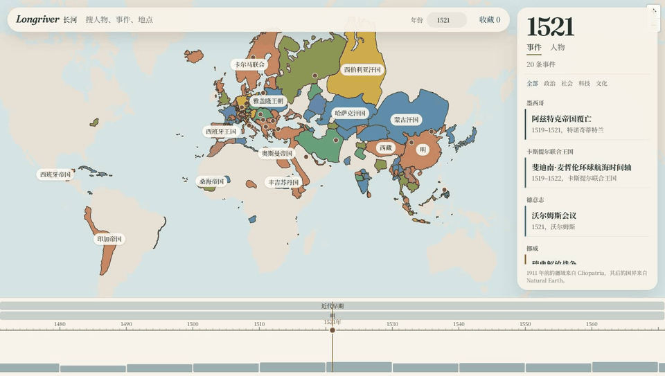
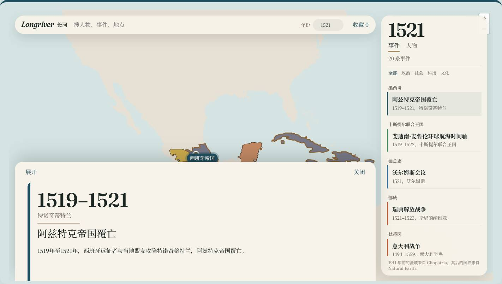

[English](../README.md) · [中文](README.zh-CN.md)

<p align="center">
  
</p>

<h1 align="center">长河</h1>

<p align="center">想看看某一年的世界，就把时间停在那一年。</p>

<p align="center">
  <a href="../LICENSE"></a>
  
  
</p>

这是一条可以离线翻完的世界史。浏览器和手机读的是同一份知识包。现在大约有 9737 条记述、5130 位人物、3617 个地点，从公元前 3000 年走到 2026 年。

<p align="center">
  
</p>

## 可以做的事

- 把时间停在某一年，疆域换成那一年的颜色。
- 右边分成两栏：事件，和人物。标签只列出这一年真正有的东西。
- 点一条，地图先飞到那个地方，并勾出当时的疆域。长文先不打开。
- 再点「阅读」，这一条被画成一张图：年份、地名、标题、一句话。更长的摘录和出处收在「原文」里。
- 配图只在打开这一条之后才去要，要到了就留下来。没有钥匙时，字图自己就立得住。
- 收藏留在做出收藏的那台设备上。

<p align="center">
  
  
</p>

人物按寿命出现：只有生年的，只出现在出生那年；有卒年的，生年到卒年都算在世。配图只收公有领域、CC0、CC BY 和 CC BY-SA，作者和许可随图走。

## 开始

### 浏览器

需要 Node.js。在 `web/` 目录：

```powershell
npm install
npm run dev
```

打开 http://127.0.0.1:5173 。页面用 Vue 3 写成。收藏和备注存在这个浏览器的 IndexedDB 里。

若希望缺图的记述在第一次打开时生成一张示意，启动前设置环境变量 `LONGRIVER_IMAGE_KEY`。没有这把钥匙时，字图照常画，不会空等。

### 手机

需要 JDK 17 和 Android SDK。在 `android/local.properties` 里按需填写，此文件不要提交：

```properties
sdk.dir=C:\\Android\\Sdk
longriver.apiBaseUrl=http://10.0.2.2:8000
tianditu.key=
```

```powershell
cd android
.\gradlew.bat :app:assembleDebug
```

调试包在 `android/app/build/outputs/apk/debug/app-debug.apk`。知识、疆域和配图来自 `content/dist/`，由 Gradle 打进安装包。手机里可以不联网翻完。

## 数据从哪来

| 内容 | 来源 | 协议 |
| --- | --- | --- |
| 1911 年及以前的疆域 | [Cliopatria](https://doi.org/10.5281/zenodo.13363121) | CC BY 4.0，轮廓已简化和按年切分 |
| 1912 年以后的陆地与国界 | [Natural Earth](https://www.naturalearthdata.com/) | 公共领域 |
| 人物、地点、事件事实 | [维基数据](https://www.wikidata.org/) | CC0 |
| 详情摘录 | 中文维基百科 | CC BY-SA 4.0，页内标明 |
| 人物与地点图片 | [维基共享资源](https://commons.wikimedia.org/) | 仅 PD / CC0 / CC BY / CC BY-SA |

维基数据里、1949 年以后且地点在中国的条目留在待审批次 `china-1949-plus`，不写入安装包。受版权保护的书籍只保留书目，不收录正文。配置天地图密钥后，1912 年以后可以改用天地图在线底图；密钥不进仓库。

地图尚未取得审图号，应用内标为内测版。历史疆域是公开数据的近似示意，不代表对现实边界的认定。台湾、香港、澳门并入中国。

## 仓库里有什么

| 路径 | 内容 |
| --- | --- |
| [`web/`](../web/) | 浏览器客户端 |
| [`android/`](../android/) | 手机应用 |
| [`content/`](../content/) | 构建共用知识包的脚本 |
| [`docs/`](../docs/) | 中文首页和本页图片 |
| [`backend/`](../backend/) | 准备数据时用的本地服务 |

重新生成知识包：

```powershell
python content/build_wikidata.py
python content/build_android_package.py
```

手机和浏览器都读 `content/dist/`。

## 何处提问

问题和勘误写在 [issues](https://github.com/XiaoYuTianTian/Longriver/issues)。怎样送一次改动，写在 [CONTRIBUTING.md](../CONTRIBUTING.md)。仓库由 [XiaoYuTianTian](https://github.com/XiaoYuTianTian) 维护。

应用不收集姓名、手机号、位置或设备标识，也不接入广告和统计 SDK。

## 许可

原创源代码使用 [MIT 许可证](../LICENSE)。

这份许可只覆盖代码。维基摘录仍是 CC BY-SA 4.0，Cliopatria 疆域仍是 CC BY 4.0，Natural Earth 仍是公共领域，维基数据事实仍是 CC0。每张图保留随文件记下的许可。

## 仓库里不会出现的东西

- `android/local.properties`、`android/keystore.properties` 和 `*.jks`
- `.env`，也包括 `LONGRIVER_IMAGE_KEY`
- `backend/db.sqlite3`
- `content/dist/media/` 和 `content/dist/detail-art/`
- `content/raw/`，维基数据查询缓存

Django 的默认 `SECRET_KEY` 只为本机使用。数据库口令 `longriver-local` 只写在本地 Postgres 编排文件里。
